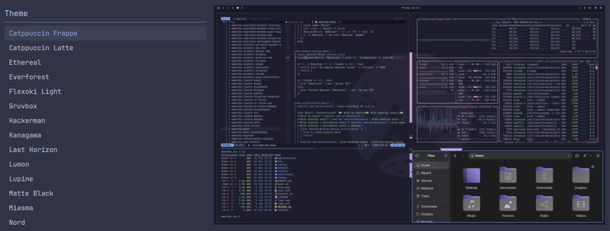

# Old Theme Switcher for Omarchy

Restores the pre-Quattro theme switcher: a **textual list of theme names with a
preview beside it**, instead of Quattro's fullscreen thumbnail carousel.



Type to filter, `Enter` applies. Nothing else on the system changes — the stock
`omarchy theme switcher` and the background picker are left alone, and no file
outside this plugin's own directory is ever written.

## Contents

- [Install](#install)
- [Opening it](#opening-it)
- [Keys](#keys)
- [How it works](#how-it-works)
  - [Files](#files)
  - [Listing themes](#listing-themes)
  - [Applying a theme](#applying-a-theme)
  - [Layout and the preview pane](#layout-and-the-preview-pane)
  - [Theming](#theming)
- [Development](#development)
- [Troubleshooting](#troubleshooting)
- [Uninstall](#uninstall)
- [Requirements](#requirements)
- [Security](#security)
- [License](#license)

## Install

```bash
omarchy plugin add https://github.com/bruce-forte/omarchy-old-theme-switcher.git --enable
```

That clones the repo into
`~/.config/omarchy/plugins/io.github.bruce-forte.old-theme-switcher/`, validates
the manifest, and enables it. Confirm it landed:

```bash
omarchy plugin list | grep old-theme-switcher
# io.github.bruce-forte.old-theme-switcher  enabled  third-party  overlay  Old Theme Switcher
```

Installing does not by itself change how you open the theme picker — do that
next.

## Opening it

The plugin is summoned by id:

```bash
omarchy-shell shell summon io.github.bruce-forte.old-theme-switcher '{}'
```

**From the Omarchy menu.** Reuse the stock `style.theme` row id in
`~/.config/omarchy/extensions/omarchy-menu.jsonc` to override it. That file
hot-reloads on save, so the change takes effect immediately:

```jsonc
{
  "style.theme": {
    "icon": "󰸌",
    "label": "Theme",
    "aliases": ["theme", "themes"],
    "action": "omarchy-shell shell summon io.github.bruce-forte.old-theme-switcher '{}'"
  }
}
```

**From a keybinding.** Bind the same command in `~/.config/hypr/bindings.lua`.

**Both.** They are independent — keeping the stock grid on the menu row and this
list on a keybinding works fine.

## Keys

| Key | Action |
|-----|--------|
| any character | filter the list |
| `Backspace` / `Ctrl+U` | delete a character / clear the filter |
| `Ctrl+Backspace` | delete a word |
| `↑` `↓`, `Tab` / `Shift+Tab`, `Ctrl+P` / `Ctrl+N` | move the selection (wraps at both ends) |
| `Home` / `End` | first / last theme |
| `Enter` | apply the highlighted theme |
| `Esc` | clear the filter, or close when it is already empty |
| click / double-click | select / apply |
| click outside the card | close |

Filtering is a case-insensitive substring match on the display name. The
selection follows the filter: when the highlighted theme is filtered away, the
first remaining match takes over.

## How it works

An `overlay` shell plugin. It runs inside the long-lived `omarchy-shell`
Quickshell process — the same one that draws the bar, the menu, and the stock
pickers — so opening it starts no new process.

The manifest is the whole contract:

| Field | Value | Why |
|-------|-------|-----|
| `schemaVersion` | `1` | The manifest contract the shell enforces |
| `id` | `io.github.bruce-forte.old-theme-switcher` | Summon address, and the install directory name. Third-party ids may not use the reserved `omarchy.*` namespace |
| `kinds` | `["overlay"]` | Fullscreen layer-shell surface |
| `entryPoints.overlay` | `Overlay.qml` | The QML the shell loads for that kind |

There is no `keepLoaded`, so the shell instantiates the overlay the first time
it is summoned rather than at startup.

### Files

| File | Role |
|------|------|
| `manifest.json` | Plugin id, kind, entry point, marketplace metadata |
| `Overlay.qml` | The surface: layer-shell window, filterable list, preview pane, key handling |
| `themes.sh` | Emits the theme list as JSON |
| `preview.png` | Screenshot for this README and the marketplace listing |

`Overlay.qml` exposes the three lifecycle hooks the shell calls: `open(payload)`
on summon, `close()` on hide, and `toggle()`. The payload is currently unused —
`'{}'` is enough — leaving it free for later options.

### Listing themes

On **every** summon, `Overlay.qml` runs `themes.sh` — located relative to itself
through `Qt.resolvedUrl(".")`, so the plugin works from any install path — and
parses its JSON:

```json
{
  "current": "Catppuccin Frappe",
  "rows": [
    { "name": "Catppuccin", "preview": "/usr/share/omarchy/themes/catppuccin/preview.png" },
    { "name": "Catppuccin Frappe", "preview": "/home/you/.config/omarchy/themes/catppuccin-frappe/preview.png" }
  ]
}
```

`themes.sh` takes the display names from `omarchy-theme-list` and, for each one:

1. Slugifies the name (lowercase, spaces to dashes) to find its directory,
   preferring `~/.config/omarchy/themes/<slug>` over
   `$OMARCHY_PATH/themes/<slug>` — the precedence Omarchy itself uses, so a user
   theme shadowing a stock one wins here too.
2. Picks a preview: the theme's own `preview.png|jpg|jpeg|webp|gif|bmp` when it
   ships one, otherwise the alphabetically first image in its `backgrounds/`
   directory. That is the stock switcher's order, so the pictures match what
   Quattro's grid would have shown. A theme with neither still lists; the pane
   just reads *No preview*.
3. Reports which theme is live, read from
   `~/.local/state/omarchy/current/theme.name` and mapped back from slug to
   display name, so the list opens with the current theme highlighted.

Reading per summon rather than caching at startup means a theme you just
installed or removed shows up without a shell restart.

### Applying a theme

`Enter` runs `omarchy-theme-set <name>` through `Quickshell.execDetached`, then
closes the overlay. Nothing is written back to whoever summoned it, so the
summon command returns immediately instead of blocking until you pick — which is
why the menu row is a plain `summon` and not a command substitution.

The theme is applied entirely by Omarchy's own machinery; this plugin has no
opinion about what a theme change should do.

### Layout and the preview pane

The card is sized around the preview rather than the other way round. Theme
previews are desktop screenshots, so the pane is fixed at **16:9** and the
card's height derives from it — the image fills the pane edge to edge with no
letterboxing, and the list column takes the width that is left.

The image is decoded at the pane's true device resolution (`sourceSize` on both
axes, times `Screen.devicePixelRatio`) and drawn with `PreserveAspectFit` plus
`mipmap`. This matters: decoding to the pane's *width* and then cropping to
cover a taller pane scales that decode back up, which is exactly how a preview
ends up looking blurry. Fitting keeps the only scaling downward, and mipmapping
keeps it clean.

### Theming

Every color comes from the shell's theme singleton (`Color.menu.background`,
`.text`, `.border`, `.selectedBackground`, `.selectedText`, `.scrim`), and every
size and font from `Style` (`Style.space`, `Style.font.*`, `Style.spacing.*`).
The picker therefore restyles itself along with the rest of the shell —
including with the theme you just applied through it — and honours your
configured font and spacing scale.

## Development

Work on a checkout, then point Omarchy at it:

```bash
omarchy plugin add /path/to/omarchy-old-theme-switcher --enable --yes   # a local path clones fine
omarchy plugin update io.github.bruce-forte.old-theme-switcher          # pull later commits
```

`plugin add` **clones**, so only committed work gets installed.

Validate and lint before publishing:

```bash
omarchy plugin validate .
qmllint -I "$OMARCHY_PATH/shell" Overlay.qml
bash themes.sh | jq .
```

Drive it by hand:

```bash
omarchy-shell shell summon io.github.bruce-forte.old-theme-switcher '{}'
omarchy-shell shell hide io.github.bruce-forte.old-theme-switcher
hyprctl layers | grep omarchy-old-theme-switcher   # the layer surface, while open
journalctl --user -f | grep qml                    # QML errors and warnings
```

**Reload rules.** Editing `themes.sh` takes effect on the next summon. Editing
`Overlay.qml` needs `omarchy restart shell` — the shell holds on to the overlay
object it already instantiated, so neither saving the file nor
`omarchy-shell shell rescanPlugins` swaps the new QML in.

To publish a change: commit, push, then submit or update the listing at the
[Omarchy plugin marketplace](https://omarchyplugins.com/).

## Troubleshooting

| Symptom | Cause and fix |
|---------|---------------|
| `summon` prints nothing and no window appears | Installed but disabled: `omarchy plugin enable io.github.bruce-forte.old-theme-switcher` |
| Still nothing, and the id is right | `omarchy plugin list` — a manifest the shell rejected never registers; `omarchy plugin validate .` says why |
| The list is empty | `omarchy-theme-list` returned nothing; run it directly |
| A theme shows *No preview* | It ships no preview image and has no backgrounds. Drop a `preview.png` into `~/.config/omarchy/themes/<slug>/` |
| QML edits do not show up | `omarchy restart shell` — see the reload rules above |
| The menu still opens the grid | The `style.theme` override is missing or malformed. `omarchy-menu.jsonc` must stay valid JSONC — one stray comma takes the whole file out |

## Uninstall

```bash
omarchy plugin remove io.github.bruce-forte.old-theme-switcher
```

Then drop the `style.theme` override from
`~/.config/omarchy/extensions/omarchy-menu.jsonc` to get the stock grid back.
Nothing else needs undoing — the plugin never wrote anywhere else.

## Requirements

- Omarchy 4 (Quattro) or newer, for the plugin API and `omarchy-shell`
- `jq`, already an Omarchy dependency

## Security

Omarchy plugins run unsandboxed, with your user's permissions, inside the
long-lived shell process. That applies to this one as much as to any other:
read `Overlay.qml` and `themes.sh` before installing — both are short. The
plugin spawns exactly two commands (`themes.sh`, which itself calls
`omarchy-theme-list`, `find`, and `jq`; and `omarchy-theme-set`), reads nothing
outside the theme directories described above, writes nothing, and makes no
network calls.

## License

Apache-2.0. See [LICENSE](LICENSE).
